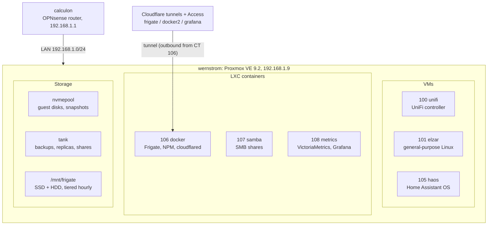

# homelab

Reference documentation for the home network and Proxmox lab. Facts are as of
2026-11-21 unless a section says otherwise.

The lab runs on one always-on Proxmox host, **wernstrom**, behind an OPNsense
router, **calculon**. A second Proxmox node, **farnsworth**, is in the cluster
but stays powered off except for experiments.

Public services are reached only through Cloudflare tunnels with Cloudflare
Access in front. The tunnel connects outbound from CT 106, so the router has no
inbound port forwards for them.

| Host | Role | Address | Notes |
| --- | --- | --- | --- |
| calculon | OPNsense router and firewall | 192.168.1.1 | FreeBSD 15.1, OPNsense 26.7; root shell is csh |
| wernstrom | Proxmox VE host | 192.168.1.9 | PVE 9.2, Ryzen 7 255, 29 GiB RAM; also on Tailscale |
| farnsworth | Proxmox VE node, usually off | — | 1 quorum vote; wernstrom has 2 |

Admin access is SSH as root to both machines. On OPNsense, pipe multi-line
commands through `/bin/sh -s`, because csh mangles quoting.

## Contents

| Document | Covers |
| --- | --- |
| [Network](docs/network.md) | Router, VLANs, DNS, DHCP, port forwards, Cloudflare, reverse proxy |
| [wernstrom](docs/wernstrom.md) | Host hardware, kernel pin, Coral driver, cluster, host customizations |
| [Guests](docs/guests.md) | Every VM and container: purpose, resources, mounts, configuration |
| [Storage](docs/storage.md) | ZFS pools, disks and their health, Frigate tiering |
| [Backups](docs/backups.md) | vzdump, sanoid/syncoid, host config backup, gaps |
| [Monitoring](docs/monitoring.md) | VictoriaMetrics, exporters, Grafana dashboards, OPNsense pf metrics |
| [Alerting](docs/alerting.md) | vmalert rules, Alertmanager routing, email delivery |
| [Runbooks](docs/runbooks.md) | Updates, kernel trials, restores, host rebuild, adding backups |
| [History and lessons](docs/history.md) | Incidents, regressions, decisions |
| [Open items](docs/open-items.md) | Known gaps and pending work |

## Secrets

No credentials live in this repository. Secrets stay on the hosts:

- Gmail app password for alert email: `/etc/prometheus/gmail-app-password` in CT 108
- Cloudflare tunnel token: the `cloudflare-tunnel` container's environment in CT 106
- Frigate's Gemini API key: `/frigate/config/config.yml` in CT 106
- NPM DNS-challenge credentials: `/etc/letsencrypt/credentials/` inside the NPM container
