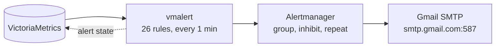

# Alerting

> **Alerts are evaluated but not delivered.** As of 2026-11-21 the Gmail
> app-password file `/etc/prometheus/gmail-app-password` in CT 108 is empty, so
> every email attempt since September has failed. To fix it, run the command
> below, paste the app password for the PVE sender account, press Enter, then
> Ctrl-D:
>
> ```bash
> ssh root@wernstrom "pct exec 108 -- sh -c \"tr -d ' \n' > /etc/prometheus/gmail-app-password\""
> ```

## Pipeline



- Rules: `/etc/vmalert/rules/homelab.yml`. Alert state is written back to
  VictoriaMetrics, so pending `for:` timers survive a restart.
- Routing: `/etc/prometheus/alertmanager.yml`. Alerts are grouped by alert
  name and instance and repeat every 12 h; a resolved alert also sends a mail.
  The sender is the same Gmail account PVE uses.
- Active alerts show at http://192.168.1.240:9093 and in Grafana through the
  Alertmanager datasource.

## Rules

| Group | Alert | Fires when | Severity |
| --- | --- | --- | --- |
| pipeline | TargetDown | a scrape target is down for 5 min | critical |
| pipeline | ScrapePipelineDead | no wernstrom data for 10 min | critical |
| pipeline | TextfileCollectorStale | a textfile collector file is over 1 h old | warning |
| pipeline | CgroupCollectorFailing | pve-cgroup-metrics reports failure | warning |
| pipeline | OpnsensePfMetricsMissing | no pf metrics for 15 min | warning |
| host | SystemdUnitFailed | any unit failed for 5 min (covers tier-down, host backup, sanoid) | warning |
| host | HostMemoryPressure | memory PSI above 10% for 15 min | warning |
| host | GuestOomKill | an OOM kill inside a guest | warning |
| host | GuestSwapFail | a guest hit its swap limit | warning |
| host | FilesystemAlmostFull | a filesystem over 85% for 30 min | warning |
| host | FilesystemFillingUp | projected full within 14 days and over 50% used | warning |
| storage | ZpoolNotOnline | a pool leaves ONLINE | critical |
| storage | DiskSmartUnhealthy | SMART overall health fails | critical |
| storage | DiskBadSectors | any reallocated, pending or uncorrectable sector | warning |
| storage | DiskCrcErrors | new UDMA CRC errors (cable or port) | warning |
| storage | DiskTooHot | HDD over 55 °C or NVMe over 70 °C for 15 min | warning |
| storage | NvmeCriticalWarning | NVMe critical warning or new media errors | critical |
| storage | NvmeWearHigh | NVMe endurance used over 80% | warning |
| backups | SnapshotsStale | no new source snapshot for 2 h | warning |
| backups | ReplicaStale | a replica is over 3 h behind | warning |
| backups | VzdumpStale | no vzdump archive for 8 days | warning |
| backups | HostConfigBackupStale | host backup over 30 h old | warning |
| backups | BackupMetricsMissing | backup exporter silent for 30 min | warning |
| frigate | CoralInferenceSlow | inference over 50 ms for 10 min | critical |
| frigate | CameraDown | a camera at 0 fps, unless it has been dark all week | warning |
| meta | Watchdog | always firing; heartbeat for a dead-man's switch | none |

Inhibitions: DiskSmartUnhealthy suppresses DiskBadSectors on the same disk, and
ScrapePipelineDead suppresses all warnings.

## Changing rules

Edit `/etc/vmalert/rules/homelab.yml` in CT 108 and validate:

```bash
/opt/victoriametrics/vmalert-prod -rule=/etc/vmalert/rules/*.yml -dryRun
systemctl reload vmalert
```

For routing changes, edit `/etc/prometheus/alertmanager.yml`, check it with
`amtool check-config`, then reload `prometheus-alertmanager`.
